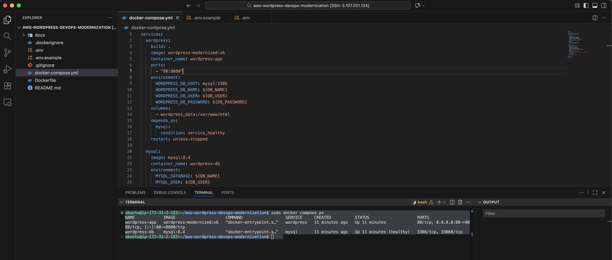
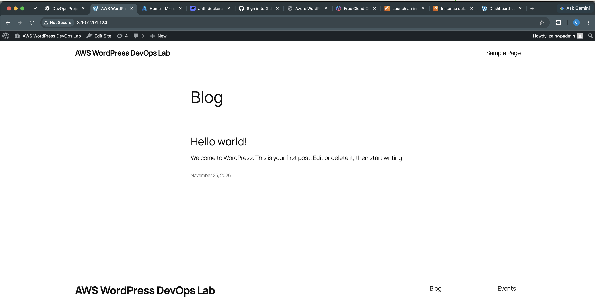

# WordPress Modernization on AWS

### DevOps Capstone Project | Docker · AWS · Container Security · Kubernetes · GitHub Actions

A hands-on DevOps engineering project focused on modernizing a WordPress application through containerization, security hardening, cloud deployment, and DevOps automation.

The project demonstrates how a traditional WordPress application can be transformed into a secure, portable, and cloud-ready application using Docker, MySQL, AWS, and modern DevOps practices.

Developed as part of the **Nisum DevOps Enablement Programme — Final Project Assignment**.

> **Project Status:** 🚧 In Progress  
> **Completed:** Docker containerization, image security hardening, vulnerability scanning, local deployment, persistent storage, and backups.  
> **Current Phase:** Preparing AWS cloud deployment.  
> **Next Milestone:** Deploy the hardened WordPress application on AWS EC2 and demonstrate public access.  
> **Planned Enhancements:** Kubernetes, CI/CD automation, monitoring, and operational improvements.

---

## 🎯 Project Objectives

The primary objectives of this project are to:

- Containerize WordPress and MySQL using Docker and Docker Compose.
- Build a customized and security-hardened WordPress Docker image.
- Identify and reduce container vulnerabilities using Trivy.
- Apply least-privilege security principles through non-root execution.
- Implement persistent storage for application and database data.
- Manage database credentials using environment variables.
- Deploy the application to AWS for a live demonstration.
- Explore Kubernetes orchestration for container management.
- Automate image builds, security scans, and deployments using GitHub Actions.
- Implement monitoring, health checks, and operational documentation.
- Measure security improvements and deployment outcomes.

---

## 🏗️ Architecture

### 1. Previous Infrastructure — Azure

The original WordPress environment was hosted using Microsoft Azure services, including:

- Azure Virtual Machine Scale Sets (VMSS)
- Azure Application Gateway
- Azure Virtual Networks
- Azure Database for MySQL Flexible Server

The original infrastructure was decommissioned following the expiration of available Azure credits.

The current project uses AWS as its target cloud platform.

### 2. Current Architecture — Local Docker Deployment

**Status: Implemented and tested**

```text
                  Developer / Browser
                           |
                           v
                  http://localhost:8080
                           |
                           v
                    Docker Compose
                           |
              +------------+------------+
              |                         |
              v                         v
      WordPress Container        MySQL Container
      Apache + PHP               MySQL 8.4
      Hardened Image v6          Persistent Database
      Non-root User              Internal Docker Network
              |                         |
              v                         v
       wordpress_data              mysql_data
        Docker Volume              Docker Volume
```

WordPress and MySQL run as separate Docker containers and communicate through Docker's internal network.

Named Docker volumes preserve application and database data when containers are recreated.

### 3. Target Architecture — AWS EC2

**Status: Planned — Not yet deployed**

```text
                   Internet Users
                         |
                         v
                  AWS Security Group
                         |
                         v
                   AWS EC2 Instance
                         |
                         v
                    Docker Engine
                         |
                         v
                    Docker Compose
                         |
              +----------+----------+
              |                     |
              v                     v
       WordPress Container     MySQL Container
       Hardened Image v6       MySQL 8.4
              |                     |
              v                     v
         Persistent Docker Volumes
```

The planned deployment will reuse the existing Docker Compose configuration, with cloud-specific adjustments where necessary.

AWS costs and Free Plan eligibility will be reviewed before creating resources.

---

## 🛠️ Technology Stack

| Category | Technologies |
|---|---|
| Cloud Platform | Amazon Web Services (AWS) |
| Cloud Compute | Amazon EC2 (planned) |
| Containerization | Docker, Docker Compose |
| Application | WordPress, PHP, Apache |
| Database | MySQL 8.4 |
| Container Security | Trivy, Linux permissions, non-root execution |
| Operating System | Linux |
| Version Control | Git, GitHub |
| CI/CD | GitHub Actions (planned) |
| Orchestration | Kubernetes (planned) |
| Monitoring | AWS CloudWatch (planned) |
| Automation | Bash, Docker CLI |

---

## 📅 Project Implementation Roadmap

### Phase 1 — Docker Containerization

**Status: Completed**

- [x] Set up the local Docker environment.
- [x] Create a custom WordPress Dockerfile.
- [x] Configure WordPress and MySQL using Docker Compose.
- [x] Establish database connectivity.
- [x] Configure persistent Docker volumes.
- [x] Verify the WordPress website locally.

### Phase 2 — Container Security Hardening

**Status: Completed**

- [x] Scan the original container image using Trivy.
- [x] Identify HIGH and CRITICAL vulnerabilities.
- [x] Pin the WordPress base image using a SHA-256 digest.
- [x] Update operating system packages.
- [x] Configure Apache to listen on port 8080.
- [x] Configure WordPress to run as a non-root user.
- [x] Apply restricted directory permissions.
- [x] Document measured vulnerability improvements.

### Phase 3 — Secure Local Deployment

**Status: Completed**

- [x] Build the hardened WordPress v6 image.
- [x] Update Docker Compose to use v6.
- [x] Back up WordPress application files.
- [x] Back up the MySQL database.
- [x] Recreate the WordPress container without restarting MySQL.
- [x] Verify the website through the browser.
- [x] Verify non-root execution and directory permissions.
- [x] Exclude local secrets and backups from Git.

### Phase 4 — AWS Cloud Deployment

**Status: Pending**

- [ ] Review AWS Free Plan restrictions and available credits.
- [ ] Configure billing alerts and budget protection.
- [ ] Provision an eligible AWS EC2 instance.
- [ ] Configure EC2 networking and security groups.
- [ ] Install Docker and Docker Compose.
- [ ] Deploy WordPress and MySQL.
- [ ] Configure persistent storage.
- [ ] Verify public website access.
- [ ] Capture deployment screenshots and operational evidence.

### Phase 5 — DevOps Automation and Kubernetes

**Status: Planned**

- [ ] Create Kubernetes manifests.
- [ ] Validate Kubernetes deployment in a suitable environment.
- [ ] Implement GitHub Actions for build and security scanning.
- [ ] Explore automated deployment and rollback.
- [ ] Configure health checks and monitoring.
- [ ] Document operational procedures and deployment measurements.

---

## 🔐 Container Security Hardening

The WordPress image was hardened using several security practices.

### 1. Pinned Base Image

A specific WordPress base image digest is used to improve build reproducibility.

### 2. Operating System Updates

Installed operating system packages are updated during the Docker image build to reduce known vulnerabilities.

### 3. Non-Root Execution

The WordPress container runs using the `www-data` user rather than root.

Verified runtime identity:

```text
uid=33(www-data) gid=33(www-data) groups=33(www-data)
```

### 4. Restricted File Permissions

The WordPress `wp-content` directory uses permission mode `755` and is owned by `www-data`.

Verified output:

```text
drwxr-xr-x 5 www-data www-data
```

### 5. Apache Port Configuration

Apache listens on container port `8080`, supporting the non-root runtime configuration.

### 6. Secrets and Backup Protection

Sensitive local files are excluded from Git through `.gitignore`.

```gitignore
.env
backups/
```

These measures reduce unnecessary privileges and improve security posture, but they do not eliminate all container vulnerabilities.

---

## 📊 Vulnerability Scanning Results

Trivy was used to compare the original WordPress image against an updated image.

| Measurement | Original Image | Updated Image (v2) |
|---|---:|---:|
| HIGH + CRITICAL vulnerabilities | 1,070 | 99 |

**Measured vulnerability reduction: approximately 90.7%.**

The recorded vulnerability comparison is based on the v2 image.

The final v6 image has been verified for non-root execution and directory permissions. A separate final Trivy vulnerability count for v6 has not yet been recorded.

Supporting measurements are available under:

`docs/measurements/`

---

## 🐳 Running the Project Locally

### Prerequisites

- Docker Engine or Docker Desktop
- Docker Compose
- Git

### Step 1 — Clone the Repository

```bash
git clone https://github.com/kazizain/azure-wordpress-aks-modernization.git
cd azure-wordpress-aks-modernization
```

### Step 2 — Configure Environment Variables

Create a `.env` file using the provided example:

```bash
cp .env.example .env
```

Configure the database variables:

```dotenv
DB_NAME=wordpress
DB_USER=wordpress
DB_PASSWORD=replace_with_secure_password
DB_ROOT_PASSWORD=replace_with_secure_root_password
```

Do not commit actual credentials to GitHub.

### Step 3 — Build and Start the Containers

```bash
docker compose up -d --build
```

### Step 4 — Verify Containers

```bash
docker compose ps
```

### Step 5 — Access WordPress

Open:

http://localhost:8080

### Step 6 — Verify Container Security

```bash
docker exec wordpress-app id
```

Check WordPress directory permissions:

```bash
docker exec wordpress-app ls -ld /var/www/html/wp-content
```

### Step 7 — Stop the Application

```bash
docker compose down
```

This stops and removes the Compose containers while preserving named volumes.

Avoid using `docker compose down -v` unless you intentionally want to delete the associated volumes.

---

## 💾 Backup and Data Persistence

The application uses two Docker volumes:

| Volume | Purpose |
|---|---|
| `wordpress_data` | WordPress application files and uploads |
| `mysql_data` | MySQL database storage |

Before upgrading the WordPress image, local backups were created.

| Backup | Recorded Size |
|---|---:|
| WordPress application archive | 26 MB |
| MySQL database SQL dump | 637 KB |

Backup files are stored locally in the ignored `backups/` directory and are not intended to be committed to the repository.

---

## 📂 Repository Structure

```text
azure-wordpress-aks-modernization/
├── Dockerfile
├── docker-compose.yml
├── .dockerignore
├── .gitignore
├── .env.example
├── docs/
│   └── measurements/
│       ├── baseline.md
│       └── v2.md
└── README.md
```

The repository will be expanded as cloud deployment, Kubernetes configuration, and CI/CD work are implemented.

---

## 📈 Future Improvements

Planned enhancements include:

- AWS EC2 deployment with public accessibility.
- Container image publishing to a registry.
- Automated builds and Trivy scans using GitHub Actions.
- Kubernetes manifests and deployment testing.
- Application health checks.
- Monitoring and operational alerting.
- Deployment and rollback documentation.
- Infrastructure cost tracking.
- AI-assisted DevOps experimentation.

These features will be marked completed only after implementation and verification.

---

## 👨‍💻 Author

**Qazi Zain**

Automation Engineer / SDET | Cloud & DevOps Learner

- [GitHub](https://github.com/kazizain)
- [LinkedIn](https://www.linkedin.com/in/kazizain)
- [Portfolio](https://zain-automation-lab.lovable.app/)

---

## AWS EC2 Deployment

Successfully deployed a containerized WordPress application with MySQL on an AWS EC2 Ubuntu 24.04 server using Docker Compose.

### Architecture

Browser → AWS EC2 (HTTP Port 80) → WordPress Docker Container (Port 8080) → MySQL Docker Container (Port 3306)

### Technology Stack

- AWS EC2 (Ubuntu 24.04, t3.micro)
- Docker and Docker Compose
- WordPress with Apache
- MySQL 8.4
- Docker named volumes for persistent data
- Environment-based database configuration

### Deployment Commands

```bash
sudo docker compose config --quiet
sudo docker compose up -d --build
sudo docker compose ps
```

### Verification

- WordPress image `wordpress-modernized:v6` built successfully.
- WordPress container running and accessible through HTTP port 80.
- MySQL container reported healthy.
- WordPress installation completed and admin dashboard accessed.

### Deployment Evidence

**Docker containers running on AWS EC2**



**WordPress website deployed on AWS EC2**



> This deployment demonstrates AWS EC2 and Docker Compose. It does not represent an AKS/Kubernetes deployment.

*This repository documents an individual DevOps learning project developed as part of the Nisum DevOps Enablement Programme.*